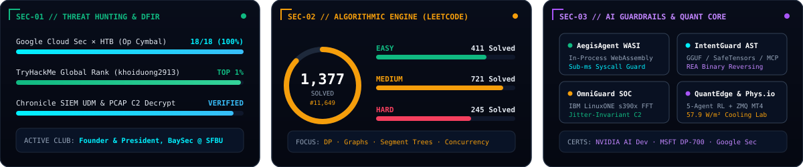

<div align="center">

<!-- ==================== ANIMATED CYBER-GALACTIC ORBITAL BANNER ==================== -->


<br />

<!-- ==================== QUICK TELEMETRY & SOCIAL LINKS ==================== -->
<p align="center">
  <a href="https://www.linkedin.com/in/khoi-duong-039a0723a/">
    
  </a>
  <a href="https://tryhackme.com/p/khoiduong2913">
    
  </a>
  <a href="https://leetcode.com/u/khoiduong2913/">
    
  </a>
  <a href="https://github.com/MynameisKoi/CTF/tree/main/Operation%20Cymbal">
    
  </a>
  <a href="https://MynameisKoi.github.io/baysec/">
    
  </a>
</p>

<!-- ==================== 3-PANEL LIVE TELEMETRY HUD ==================== -->


</div>

---

## 🎮 `0x00 // INTERACTIVE ORBITAL MINI-CTF` — *Can You Decrypt the Beacon?*

> **Incoming Transmission:** Our **SpectraC2** sensor on IBM LinuxONE (`s390x`) intercepted an obfuscated beacon from an unknown orbital probe. Click the interactive terminal modules below to analyze the packet and capture the flag!

<details>
<summary><b>📡 [STEP 1] Click to Inspect Intercepted Telemetry Packet (PCAP Hex Dump)</b></summary>
<br />

```yaml
TIMESTAMP: 2026-11-04T21:58:00Z
SOURCE_NODE: ORBITAL-RELAY-09 (TLS 1.3 Jitter: 14.2%)
CIPHER_MODE: Single-Byte XOR (Key = 0x2A)
PAYLOAD_HEX: 61 65 63 51 1a 78 68 1b 7e 1e 66 75 79 19 64 7e 1b 64 19 66 75 1b 19 1d 1d 57
```

> **Challenge:** Decode `PAYLOAD_HEX` by XORing each byte against key `0x2A` (`42` in decimal). What is the flag?
</details>

<details>
<summary><b>💡 [STEP 2] Need a Recon Hint? Click to Generate Python Solver One-Liner</b></summary>
<br />

Run this in any Python terminal (or compute the first few ASCII bytes: `0x61 ^ 0x2A = 0x4B ('K')`):

```python
bytes.fromhex("616563511a78681b7e1e66757919647e1b641966751b191d1d57")
print("".join(chr(b ^ 0x2A) for b in bytes.fromhex("616563511a78681b7e1e66757919647e1b641966751b191d1d57")))
```
</details>

<details>
<summary><b>🚩 [STEP 3] Click to Verify Flag & Unlock Operator Clearance</b></summary>
<br />

```text
[+] DECRYPTION SUCCESSFUL!
[+] CAPTURED FLAG: KOI{0RB1T4L_S3NT1N3L_1377}
[+] CLEARANCE GRANTED: Welcome aboard the Command Deck! Feel free to connect on LinkedIn or inspect the repositories below.
```
</details>

---

## 🛰️ `0x01 // FLAGSHIP ENGINEERING & SECURITY SYSTEMS`

<table>
  <tr>
    <td width="50%" valign="top">
      <h3>🛡️ <a href="https://github.com/MynameisKoi/omniguard">OmniGuard SOC</a></h3>
      <p><b>Autonomous Multi-Modal Threat Defense, FFT Encrypted C2 Analytics &amp; Neo4j Graph Triage</b></p>
      <p>
        
        
        
      </p>
      <ul>
        <li><b>VerifyEye:</b> Visual &amp; DOM-level zero-hour phishing interception with client input locking.</li>
        <li><b>SpectraC2:</b> Non-decrypting Fast Fourier Transform (FFT) detection of jittered (0–50%) TLS 1.3 C2 beacons.</li>
        <li><b>Graph Triage:</b> Local Ollama LLM + Neo4j multi-hop lateral movement correlation mapped to MITRE ATT&amp;CK v15.</li>
      </ul>
    </td>
    <td width="50%" valign="top">
      <h3>🧬 <a href="https://github.com/MynameisKoi/intent-guard">IntentGuard</a></h3>
      <p><b>Agentic AI Reverse Engineering, Model Integrity &amp; Semantic Intent Security Platform</b></p>
      <p>
        
        
        
      </p>
      <ul>
        <li>Audits AI agent skills, <b>MCP tool definitions</b>, Hugging Face cards, and binary weights (<code>GGUF</code>, <code>SafeTensors</code>, <code>Pickle</code>).</li>
        <li>Combines deterministic <b>Python AST tracing</b>, <b>REA binary reverse engineering</b>, and Jinja SSTI detection.</li>
        <li>Replays <b>8 adversarial attack scenarios</b> with honeytokens to expose undeclared runtime intent.</li>
      </ul>
    </td>
  </tr>
  <tr>
    <td width="50%" valign="top">
      <h3>⚡ <a href="https://github.com/MynameisKoi/aegis-agent">AegisAgent</a> · <a href="https://aegis-agent.vercel.app">[Live Web SOC ↗]</a></h3>
      <p><b>Autonomous Red-Team Fuzzing &amp; WebAssembly (WASI) Micro-Sandboxing for AI Agents</b></p>
      <p>
        
        
        
      </p>
      <ul>
        <li>Dual-sided containment engine pairing <b>adversarial prompt mutation fuzzing</b> with deterministic in-process <b>WebAssembly (WASI)</b> sandboxing.</li>
        <li>Sub-millisecond capability-based syscall interception preventing host filesystem escape or token exfiltration.</li>
      </ul>
    </td>
    <td width="50%" valign="top">
      <h3>📈 <a href="https://github.com/MynameisKoi/quantedge">QuantEdge AI</a></h3>
      <p><b>Autonomous Multi-Asset Algorithmic Trading System (5-Agent Macro Consensus + Bandit RL)</b></p>
      <p>
        
        
        
      </p>
      <ul>
        <li>5-agent cloud macro committee gating technical entries across <b>XAUUSD, USOIL, BTCUSD, and EURUSD</b>.</li>
        <li>Setup-aware <b>Contextual Bandit RL (UCB)</b> policy &amp; Bayesian optimizer (<code>scikit-optimize</code>) with 24h post-mortems.</li>
        <li>Low-latency <b>ZeroMQ IPC</b> execution bridge to MetaTrader 4 with deterministic 1% equity risk gates.</li>
      </ul>
    </td>
  </tr>
  <tr>
    <td width="50%" valign="top">
      <h3>🔬 <a href="https://github.com/MynameisKoi/Phys.io">Phys.io — Radiative Cooling AI Lab</a> · <a href="https://www.physiolearning.courses/">[Live ↗]</a></h3>
      <p><b>7th Global AI Hackathon (Databricks × Hack-Nation × MIT Club)</b></p>
      <p>
        
        
        
      </p>
      <ul>
        <li>Explored &gt;10<sup>14</sup> nanophotonic thin-film configurations via transfer-matrix physics simulation.</li>
        <li>Discovered a rare-earth-free 4-layer <code>Si3N4/SiO2</code> stack achieving <b>57.9 W/m² net cooling power</b>, outperforming the 2014 Stanford <i>Nature</i> baseline.</li>
      </ul>
    </td>
    <td width="50%" valign="top">
      <h3>🤖 <a href="https://github.com/MynameisKoi/barry">BARRY</a> &amp; 🎙️ MoneyPenny</h3>
      <p><b>Cyber-Physical Quadruped VR Robotics &amp; Hardware Zero-Trust Agent Gates</b></p>
      <p>
        
        
        
      </p>
      <ul>
        <li><b>BARRY:</b> Fuses <b>Flipper Zero NFC</b> hardware credential verification, <b>DOGZILLA S1/S2 quadruped robot</b> locomotion, YOLOv8 vision, and a <b>Meta Quest 3S VR</b> command center.</li>
        <li><b>MoneyPenny (UC Berkeley AI Hackathon):</b> Voice-driven <code>PydanticAI</code> + <code>Fetch.ai</code> platform guarded by a physical <b>Raspberry Pi 5 (QNX)</b> HMAC touch gate.</li>
      </ul>
    </td>
  </tr>
</table>

<details>
<summary><b>📂 Click to Expand 9 Additional Security, SIEM & Full-Stack Systems (Bayhawk-Eye, CONTRAGOLPE, TalentProof, UniFlow, KryptosProof...)</b></summary>
<br />

| System | Event / Context | Core Architecture & Impact |
| :--- | :--- | :--- |
| **[Bayhawk-Eye SIEM](https://github.com/MynameisKoi/bayhawk-eye)** | Enterprise SIEM & UX Engine | Mathematically defensible dual-scoring SIEM unifying **Security Posture Score (SPS: 1–10)** and **User Experience Score (UXS: 1–10)** mapped to CIS v8, NIST CSF & SOC 2. |
| **[CONTRAGOLPE](https://github.com/MynameisKoi/contragolpe)** | AWS Builder Loft AI Security Hackathon | Browser-based adversarial AI wargame teaching **OWASP Top 10 for LLM Applications** with simulated MCP tool telemetry and Snyk verification. |
| **[TalentProof](https://github.com/MynameisKoi/talentproof)** | Serverpod Hackathon | Deterministic code-level verification engine built on **Serverpod 4.0 & Flutter** (`AST_VERIFIED`, `CONFIG_FOUND`, `TEST_COVERAGE`) with WebSocket streaming. |
| **[UniFlow AI](https://github.com/MynameisKoi/uniflow)** | 🏆 **1st Place Champion — ThinkNext 2026** | 3-agent career readiness & sub-second STAR voice interview assessment engine powered by **PydanticAI, Gemini API & ChromaDB RAG**. |
| **[SmartStock BLE](https://github.com/MynameisKoi/SmartStock-BLE-Tracker)** | 🏆 **Grand Prize Champion — BayHack 2025** | Real-time Bluetooth Low Energy (BLE) inventory & campus asset telemetry platform integrated with Google Gemini AI diagnostics. |
| **[KryptosProof](https://github.com/MynameisKoi/kryptosproof)** | Hack Hayward 2026 | Automated multi-agent **Red Team → Blue Team** web vulnerability exploit and patch verification pipeline inside isolated Docker sandboxes. |
| **[App-Security-Score](https://github.com/MynameisKoi/app-security-score)** | Zero-Trust Container Scanner | Scores public GitHub repos (0–10) via **Snyk SCA + SAST** inside two-stage ephemeral `--rm` Docker volumes with zero host exposure. |
| **[Ember-Eye](https://github.com/MynameisKoi/Ember-Eye)** | BayHawk Hackathon 2.0 | Multi-modal wildfire detection pipeline fusing **AlertCA YOLOv8 cameras**, **NASA FIRMS satellite thermal data**, and GPT-4o reasoning. |
| **[DTIP](https://github.com/MynameisKoi/dtip-project)** | Ethereum Threat Intel | Censorship-resistant Indicators of Compromise (IoC) registry on **Ethereum (Solidity, Hardhat, OpenZeppelin, off-chain ECDSA)**. |

</details>

---

## 🏆 `0x02 // COMPETITIVE TROPHIES, CTF WRITE-UPS & CREDENTIALS`

- 🎯 **100% Solo Clear (18/18 Solved, 2,075 pts, Rank #458 / 1,716 Global Teams)** — **[Google Cloud Security × Hack The Box: Operation Cymbal: Cold Room (2026 CTF)](https://github.com/MynameisKoi/CTF/tree/main/Operation%20Cymbal)**
  - *Track 1 (Deceptive Click):* SocGholish WordPress drive-by, `svchost.exe` hollowing & Active Directory MSSQL Kerberoasting in **Google SecOps (Chronicle SIEM)**.
  - *Track 2 (OAuth Heist):* ShinyHunters / UNC6240 Okta SSO phishing, malicious `ToggleBox` OAuth app purging MFA alert emails, & `zstd` DB exfiltration.
  - *Track 3 (Rogue Synthesis):* Dissected **PROMPTFLUX** AI malware where a typosquatted VS Code extension queried the **Google Gemini API** to dynamically synthesize & compile C malware (`cache_worker.c` → `sys_worker.exe`) at runtime.
- 🛡️ **Top 1% Worldwide Operator on TryHackMe ([`khoiduong2913`](https://tryhackme.com/p/khoiduong2913))** — Full write-ups & Python solvers in [`MynameisKoi/CTF`](https://github.com/MynameisKoi/CTF) (*Havoc C2 AES-256-CTR Decryption*, *OneNote RC4 Streams*, *MS-OVBA Macros*, *ELF `x86_64` Binary Reversing*).
- 🏆 **2× Hackathon 1st Place Champion** — **Champion** of *SFBU ThinkNext Hackathon 2026* & **Grand Prize Champion** of *SFBU BayHack 2025*.
- 🎓 **M.S. in Computer Science (3.78 GPA) & B.S. in Computer Science (3.73 GPA)** @ San Francisco Bay University — **3× President's List Honoree**, **Founder & President of [BaySec @ SFBU](https://MynameisKoi.github.io/baysec/)**, and Campus IT Support Assistant (99.5% uptime across 1,000+ assets).
- 📜 **Certifications:** **NVIDIA Certified Professional AI Application Developer** · **Microsoft DP-700 Fabric Data Engineering** · **Google Cybersecurity Professional** · **Google IT Support Professional**.

---

## 📊 `0x03 // LIVE VERIFIED TELEMETRY FEEDS`

<div align="center">
  <a href="https://leetcode.com/u/khoiduong2913/">
    
  </a>
  &nbsp;&nbsp;
  <a href="https://tryhackme.com/p/khoiduong2913">
    
  </a>
</div>
